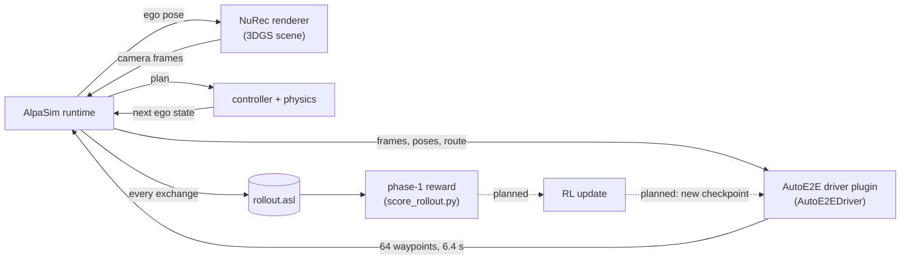

# Closed-loop fine-tuning of AutoE2E: overview

| Field | Value |
|---|---|
| Status | The closed-loop driver and the phase-1 reward exist. The RL loop that fine-tunes the policy is planned. |
| Scope | How AutoE2E runs closed-loop in NVIDIA AlpaSim, what one rollout produces, and where fine-tuning plugs in |
| Code | [`Model/plugins/alpasim_driver/`](../../Model/plugins/alpasim_driver/) (PR [#177](https://github.com/autowarefoundation/auto_e2e/pull/177)) |
| Design | [`Design/reinforcement_learning.md`](../../Design/reinforcement_learning.md) |
| Walkthrough | [`walkthrough.ipynb`](walkthrough.ipynb) |

## 1. What exists and what is planned

| Piece | Status | Where |
|---|---|---|
| AutoE2E as an AlpaSim driver: rig profiles, input parser, control integration | implemented | `alpasim_autoe2e/plugin.py`, `parser.py`, `config.py` |
| nuPlan rig rendered in NVIDIA NuRec scenes (`driver=autoe2e_nuplan`) | implemented, runs closed-loop | `configs/driver/autoe2e_nuplan*.yaml` |
| KITScenes rig (`driver=autoe2e`) | implemented, but no KITScenes world to run it in | `configs/driver/autoe2e*.yaml` |
| Phase-1 reward: deviation from the recorded drive, 3 m renderer bound | implemented as a library; the driver does not call it | `alpasim_autoe2e/rewards.py` |
| Scoring a finished rollout with that reward | implemented | `tools/score_rollout.py` |
| Map and route as model inputs in simulation | planned; the model runs on its camera-only track | Design §5.2 |
| RL environment, rollout collection, policy update | planned | Design §6–7 |
| `SimAdapter` (latent/pixel rollouts), `RewardRegistry`, phase-2 reward | planned | Design §6.2, §7 |

## 2. Where closed-loop fine-tuning fits

The released checkpoints are trained by imitation, open loop:

1. The model learns to predict the logged future from logged sensor data. The stages are `nuplan_full`, then optionally `l2d_continuation` or `kitscenes_finetune` (`training/reactive_multitask.py`).
2. Every training sample comes from the expert's own drive, so the model never sees the consequences of its own mistakes.
3. Small errors compound when it drives itself.

Closed-loop fine-tuning ("Stage-3" in the design document) starts from such a checkpoint and lets the policy drive in a simulator. A NuRec 3D Gaussian-splatting reconstruction of a real drive re-renders the cameras from wherever the ego actually is, and a reward scores what the policy did. The reconstruction is only reliable near the recorded path, which shapes the reward (§6).

## 3. The loop



The runtime, renderer, driver, controller and physics are AlpaSim services: Docker containers with `deploy=local`. The wizard starts them, plays a scene and collects the logs. The dashed edges do not exist yet.

## 4. One decision

Every 0.1 s of simulated time (`control_timestep_us`), AlpaSim calls `AutoE2EDriver.predict(PredictionInput)`.

**What the driver receives:**
- the frames of each camera it asked for: `context_length: 8`, `subsample_factor: 5`, so 8 frames 500 ms apart
- the ego pose history in AlpaSim's local frame
- speed and acceleration
- a discrete command, and the latest route as waypoints in the rig frame. AutoE2E uses neither today.

**What the parser builds** (`AlpasimStreamParser`, the tensors of the packed training data):

| Model input | Shape | Built from |
|---|---|---|
| `camera_tiles` | `[1, 6, 3, 512, 512]` | newest frame of each camera, squashed to a square, ImageNet-normalised |
| `front_camera_tile` | `[1, 3, 1024, 1024]` | newest front frame (nuPlan rig) |
| `camera_history_tiles` | `[1, 7, 6, 3, 512, 512]` | the seven previous frames |
| projections | `[1, 6, 3, 4]`, `[1, 7, 6, 3, 4]` | rig calibration; history projections map current-ego points into each past image |
| `egomotion_history` | `[1, 256]` | 64 rows of speed, acceleration, yaw rate, curvature from the poses, using the dataset's curvature rule |
| `map_context`, `route_mask` | `[1, 14, 450, 300]`, `[1, 2, 450, 300]` | zeros, with `map_valid = route_valid = False` |

**The model** is the reactive BEVFormer T8 network: a ResNet-50 backbone, BEVFormer v2 fusion, map/route fusion, and a GRU planner with about 80 M parameters. It is rebuilt from the `config` stored in the checkpoint. It outputs 64 steps of (acceleration, curvature). The training rollout `integrate_controls_torch` turns those into 64 waypoints at 10 Hz, which are returned anchored at `t0`, the time of the newest frame.

## 5. One rollout

`driver=autoe2e_nuplan` on the default scene `clipgt-01d503d4…` with `n_sim_steps: 200` (20 s):

1. **Warm-up, the first 7 s** (`force_gt_duration_us: 7_000_000`, `skip_driver_during_force_gt: true`). The ego replays the recording and the driver is not called. Frames and poses still accumulate, so that the 6.4 s egomotion history and the 3.5 s camera history are real when AutoE2E takes over.
2. **Driving, the remaining 13 s.** AutoE2E decides every 0.1 s, about 130 decisions. The controller tracks the newest plan, physics moves the ego, and the renderer re-renders the cameras from the new pose.
3. **Outputs.** In `<log_dir>/rollouts/<scene>/<batch>/`:
   - `rollout.asl`, which holds:
     - the rollout metadata, including the recorded drive
     - every camera frame sent to the driver (`driver_camera_image`, about 130 MB per 20 s)
     - every plan and every route
     - the controller and physics exchanges
   - `metrics.parquet`
   - a video of the front camera (`*.mp4`)

   `<log_dir>/aggregate/` holds AlpaSim's own metrics summary.

   The [walkthrough](walkthrough.ipynb) visualises all of this (part 6):
   - AlpaSim's own video
   - bird's-eye views on the scene's vector map
   - the ego against the recording
   - the infractions, step by step
   - the camera frames the driver received

Each decision recomputes the bird's-eye view of all eight frames, so the loop waits for the driver and runs far slower than real time. The numbers measured on this setup are in §8.

## 6. The phase-1 reward

`GroundTruthDeviationReward` (`rewards.py`) scores each decision. It is the reward agreed in #123 and #177: the imitation objective turned into a reward.

```text
R = w_track · R_track + R_bound
R_track = −(1.0 · ADE + 0.5 · FDE)    plan vs. recorded drive, same timestamps, rig frame at decision time
R_bound = −10 and truncated = True     once the ego itself is more than 3 m from the recorded drive
```

- **The bound is a property of the renderer**, not a driving preference. Beyond about 3 m the reconstruction is under-sampled, so the bound acts on where the cameras are, not on where the plan ends.
- **It also prevents a stopped ego.** If the ego stops, the recording keeps moving: ADE and FDE grow, and the bound soon fires.
- **Truncation is only reported.** AlpaSim keeps driving to the end of the scene. Ending the episode will be the RL environment's job.
- **AlpaSim's summary cuts the timeline.** Its own evaluation (`aggregate/metrics_results.txt`) stops counting at the first off-road or collision, or once the ego is 4 m from the recorded trajectory, whichever comes first. Its summary therefore only describes the rollout up to that point. The per-step values in `metrics.parquet` cover the whole rollout.
- **Scoring a run:** `tools/score_rollout.py <rollout.asl>` scores a finished rollout, one row per decision.

**Example: the verification run behind §8** (nuPlan Epoch 5, default scene):
- The first decisions scored about −0.8, with ADE 0.34 m and FDE 0.9 m.
- The ego passed the 3 m bound at decision 41 of 129 and ended 34 m from the recorded drive, so 89 decisions were truncated.
- AlpaSim's per-step metrics flag the ego as off-road from 4.1 s to 5.0 s after the takeover. There was no collision.
- Over the whole rollout the ego drove 57 m against the recording's 74 m (`progress` 0.62).
- AlpaSim's summary reports `offroad` 0 and `progress` 0.38 instead, because its evaluation stopped at 3.9 s, when the ego reached 4 m from the recording.

## 7. The fine-tuning loop (planned)

None of this exists yet; see `Design/reinforcement_learning.md` §6–7.

1. **Environment.** Wrap AlpaSim so that an episode ends at the first truncated decision. It must also turn the log into training samples. `rollout.asl` already holds the frames the policy saw, its plans and the recorded drive, so no re-rendering is needed.
2. **Rollouts.** Collect them across many scenes, in one of two tiers:
   - **Tier-P:** the full pixel simulator, AlpaSim plus NuRec, as in the walkthrough.
   - **Tier-L:** faster rollouts in the JEPA world model's latent space, behind a `SimAdapter`.
3. **Update.** The design document does not choose the update algorithm.
   - It keeps imitation as a regularisation term, `−λ·D(π ‖ π_IL)`, following RAD.
   - Phase 2 extends the reward through a `RewardRegistry`, with safety, progress, comfort and faithfulness-gated reasoning terms.
4. **Re-evaluation.** Re-run the new checkpoint in the same closed loop.

The [walkthrough](walkthrough.ipynb) stops at step 1's input: the per-decision table of poses, plans, rewards and truncation that one rollout yields.

## 8. Run it yourself

The steps below were verified on 2026-10-30 against AlpaSim `affc2eab20` (2× A100 80GB, Docker with the NVIDIA runtime).

**1. Get access.**
- Accept the license of the gated Hugging Face dataset `nvidia/PhysicalAI-Autonomous-Vehicles-NuRec` with the account of your `HF_TOKEN`. The scene download fails with HTTP 403 until you do. Reading the dataset's README succeeds either way, so it proves nothing.
- The NuRec renderer image (`nvcr.io/nvidia/nre/nre-ga:26.04`) pulls without an NGC login.

**2. Set up AlpaSim with the plugin.**
- Pin AlpaSim to `affc2eab20`; the plugin needs `68709245a5` or later.
- Install a Rust toolchain; `setup_local_env.sh` builds a Rust package.
- Copy `Model/plugins/alpasim_driver` into `$ALPASIM_ROOT/plugins/`.
- Apply [`alpasim-affc2eab20.patch`](alpasim-affc2eab20.patch) with `git -C $ALPASIM_ROOT apply <auto_e2e>/Docs/closed_loop/alpasim-affc2eab20.patch`. It registers the extra and the workspace source, re-includes the plugin in `.dockerignore`, adds the `--extra` to the Dockerfile, and adds the plugin to `setup_local_env.sh`.
- Run `source setup_local_env.sh`.
- Check with `AUTOE2E_MODEL_ROOT=<auto_e2e>/Model uv run alpasim-info`: it must list `autoe2e` under Models.

**3. Build the image.** Run `docker build -t alpasim-base:latest $ALPASIM_ROOT`.

**4. Stage the assets.** Copy the checkpoint and a copy of `Model/` (without `tests/`) to `$ALPASIM_ROOT/data/drivers/autoe2e/`. That directory is `/mnt/drivers/autoe2e` in the containers.

**5. Run.**

```bash
cd $ALPASIM_ROOT && uv run --project src/wizard alpasim_wizard \
    deploy=local topology=1gpu driver=autoe2e_nuplan \
    driver.model.checkpoint_path=/mnt/drivers/autoe2e/checkpoint.pt \
    defines.base_image=alpasim-base:latest \
    wizard.log_dir=$PWD/outputs/autoe2e_closed_loop_run \
    "hydra.searchpath=[file://$ALPASIM_ROOT/plugins/alpasim_driver/alpasim_autoe2e/configs]"
```

To test the plumbing first, use `checkpoint_path=MOCK`, which drives straight without a model and skips the parser.

**6. Test without a simulator.** `test_alpasim_stream.py` skips itself entirely unless AlpaSim's packages are importable, so run it with AlpaSim's venv:

```bash
cd Model && $ALPASIM_ROOT/.venv/bin/python -m pytest tests/test_alpasim_stream.py tests/test_rewards.py
```

Add `-m integration` with `AUTOE2E_CHECKPOINT` set to run the real model.

**Measured on this setup** (nuPlan Epoch 5, `topology=1gpu`, one A100 80GB, on 2026-10-30):

| | This setup | Plugin README (V100 driver, RTX 4050 renderer) |
|---|---|---|
| One decision, offline (walkthrough, first call) | 7.8 s | 19 s first call, 10.5 s after |
| One 0.1 s simulation step while AutoE2E drives | 8.2 s | |
| One step during the warm-up, without the driver | 0.16 s | 0.32 s |
| Peak GPU memory, all services on one GPU | 13.4 GiB (mid-run: renderer 7.0, driver 4.1, physics 0.5 GiB) | about 8.2 GiB |
| Wall time for the 20 s scene, startup included | 21.5 min (`MOCK`: 4.2 min) | about 24 min |

## 9. Limitations and open questions

- **Camera-only.** The released checkpoints were trained with map and route conditioning (`enable_route_conditioning: true`), but in simulation they run with both zeroed. AlpaSim passes no map. It does pass the route as rig-frame waypoints (`PredictionInput.route`), so rasterizing it into `route_mask` the way imitation learning does is the natural next step.
- **Rendering domain gap.** The model was trained on real images. The nuPlan rig is rendered in NVIDIA scenes away from the cameras that recorded them, and reconstructed vehicles show artifacts.
- **No KITScenes or nuPlan worlds yet.** KITScenes needs a reconstruction pipeline (the HUGSIM study in #140), so `driver=autoe2e` cannot run closed-loop today.
- **Driving quality.** A reviewer of #177 reported that closed-loop driving quality looked low. Whether that comes from the implementation, the domain gap or the camera-only inputs is open.
- **Speed.** At several seconds per decision, a 20 s scene takes tens of minutes. RL at scale needs the latent tier, or a much faster driver.
